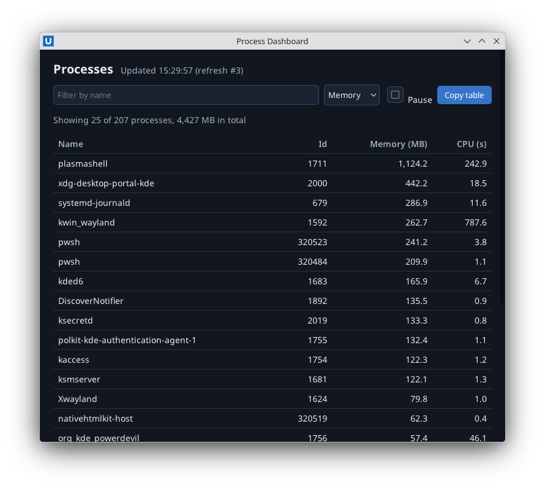

# Tutorial: a live process dashboard

You will build **Process Dashboard**: a native window with a table of running processes that
refreshes itself in the background, can be filtered and sorted, paused, and copied to the
clipboard. It works the same on Linux (PowerShell 7) and Windows (PowerShell 7 or Windows
PowerShell 5.1).



*Real capture on KDE Plasma 6.6 Wayland with Core 1.0.3 and PowerShell SDK 0.1.2 on PowerShell 7.7.*

**Time:** about 30 minutes. **You need:** the `NativeHTMLKit` module and the first window from
[getting started](../getting-started.md). The three scripts are in
[`examples/process-dashboard/`](https://github.com/nativehtmlkit/nativehtmlkit-powershell/tree/main/examples/process-dashboard);
the final app is [`app.ps1`](https://github.com/nativehtmlkit/nativehtmlkit-powershell/blob/main/examples/process-dashboard/app.ps1). All three are run against the real host by this
repository's tests.

## Step 1: a table from `Get-Process`

```powershell title="step1-snapshot.ps1"
# Process dashboard tutorial, step 1: show a table of the busiest processes in a native window.
#
# Teaches: Start-NativeHTMLKitScript, New-NativeHTMLKitWindow, Open-NativeHTMLKitHtml, building
#          HTML rows from objects with HtmlEncode, Set-NativeHTMLKitDocumentHtml, Wait-NativeHTMLKit.
# Run:     pwsh -File step1-snapshot.ps1      (Windows PowerShell 5.1: powershell.exe -File step1-snapshot.ps1)
# Guide:   docs/tutorials/process-dashboard.md (step 1 of 3)
$ErrorActionPreference = 'Stop'
Import-Module NativeHTMLKit -ErrorAction Stop
# The host runs this script again as its backend: everything below this line runs in that backend.
$app = Start-NativeHTMLKitScript -Name 'Process Dashboard'

$page = @'
<!doctype html>
<html><head><meta charset="utf-8"><style>
  body { font: 14px sans-serif; margin: 0; background: #11161f; color: #e6ebf3; }
  main { padding: 18px 22px; }
  h1 { font-size: 20px; margin: 0 0 12px; }
  table { border-collapse: collapse; width: 100%; }
  th, td { text-align: left; padding: 6px 8px; border-bottom: 1px solid #2a3445; }
  th { color: #9fb0c8; font-weight: 600; }
  td.num, th.num { text-align: right; }
</style></head>
<body><main>
  <h1>Top processes by memory</h1>
  <table>
    <thead><tr><th>Name</th><th class="num">Id</th><th class="num">Memory (MB)</th><th class="num">CPU (s)</th></tr></thead>
    <tbody id="rows"></tbody>
  </table>
</main></body></html>
'@

function ConvertTo-HtmlText([string]$Text) { return [System.Net.WebUtility]::HtmlEncode($Text) }

function Get-ProcessRowsHtml([int]$Top) {
    $rows = Get-Process | Sort-Object WorkingSet64 -Descending | Select-Object -First $Top | ForEach-Object {
        '<tr><td>{0}</td><td class="num">{1}</td><td class="num">{2:N1}</td><td class="num">{3:N1}</td></tr>' -f `
            (ConvertTo-HtmlText $_.ProcessName), $_.Id, ($_.WorkingSet64 / 1MB), [double]$_.CPU
    }
    return ($rows -join '')
}

try {
    $window = New-NativeHTMLKitWindow -Application $app -Title 'Process Dashboard' -Width 720 -Height 560
    $doc = Open-NativeHTMLKitHtml -Window $window -Html $page
    Set-NativeHTMLKitDocumentHtml -Document $doc -Element rows -Html (Get-ProcessRowsHtml -Top 15)
    Set-NativeHTMLKitReady -Application $app
    Wait-NativeHTMLKit -Application $app -UntilShutdown
} finally {
    Close-NativeHTMLKit -Application $app
}
```

Run `pwsh -File step1-snapshot.ps1`.

- The page lives in a single-quoted here-string (`@' ... '@`), so PowerShell does not expand `$` or
  backticks inside the HTML.
- `Get-ProcessRowsHtml` builds `<tr>` rows with the `-f` format operator. Process names are not
  under your control, so each one goes through `[System.Net.WebUtility]::HtmlEncode` before it
  becomes markup.
- `Set-NativeHTMLKitDocumentHtml -Element rows` replaces the children of `<tbody id="rows">`.
- `Set-NativeHTMLKitReady` comes after the first content is in place, so the window opens with a
  filled table.

## Step 2: filter and sort

```powershell title="step2-filter.ps1"
# Process dashboard tutorial, step 2: filter and sort the table.
#
# Teaches: Register-NativeHTMLKitDocumentEvent for "input" and "submit" events, reading controls with
#          Get-NativeHTMLKitValue, keeping view state in one object that callbacks can change,
#          Set-NativeHTMLKitDocumentText for untrusted text.
# Run:     pwsh -File step2-filter.ps1        (Windows PowerShell 5.1: powershell.exe -File step2-filter.ps1)
# Guide:   docs/tutorials/process-dashboard.md (step 2 of 3)
$ErrorActionPreference = 'Stop'
Import-Module NativeHTMLKit -ErrorAction Stop
$app = Start-NativeHTMLKitScript -Name 'Process Dashboard'

$page = @'
<!doctype html>
<html><head><meta charset="utf-8"><style>
  body { font: 14px sans-serif; margin: 0; background: #11161f; color: #e6ebf3; }
  main { padding: 18px 22px; }
  h1 { font-size: 20px; margin: 0 0 12px; }
  form { display: flex; gap: 8px; margin-bottom: 10px; }
  input, select { background: #1b2331; color: #e6ebf3; border: 1px solid #3a475c; border-radius: 5px; padding: 6px; }
  #filter { flex: 1; }
  button { background: #3574c6; color: white; border: 0; border-radius: 5px; padding: 6px 12px; }
  table { border-collapse: collapse; width: 100%; }
  th, td { text-align: left; padding: 6px 8px; border-bottom: 1px solid #2a3445; }
  th { color: #9fb0c8; font-weight: 600; }
  td.num, th.num { text-align: right; }
  #summary { color: #9fb0c8; }
</style></head>
<body><main>
  <h1>Processes</h1>
  <form id="view-form">
    <input id="filter" type="search" placeholder="Filter by name" aria-label="Filter by name">
    <select id="sort" aria-label="Sort by">
      <option value="memory">Memory</option><option value="cpu">CPU time</option><option value="name">Name</option>
    </select>
    <button id="apply">Refresh</button>
  </form>
  <p id="summary"></p>
  <table>
    <thead><tr><th>Name</th><th class="num">Id</th><th class="num">Memory (MB)</th><th class="num">CPU (s)</th></tr></thead>
    <tbody id="rows"></tbody>
  </table>
</main></body></html>
'@

function ConvertTo-HtmlText([string]$Text) { return [System.Net.WebUtility]::HtmlEncode($Text) }

function Update-View {
    $filter = (Get-NativeHTMLKitValue -Document $doc -Element filter).Trim()
    $sort = Get-NativeHTMLKitValue -Document $doc -Element sort
    $all = @(Get-Process)
    $shown = @($all | Where-Object { $filter -eq '' -or $_.ProcessName.IndexOf($filter, [StringComparison]::OrdinalIgnoreCase) -ge 0 })
    $sorted = switch ($sort) {
        'cpu'  { $shown | Sort-Object { [double]$_.CPU } -Descending }
        'name' { $shown | Sort-Object ProcessName }
        default { $shown | Sort-Object WorkingSet64 -Descending }
    }
    $html = @($sorted | Select-Object -First 25 | ForEach-Object {
        '<tr><td>{0}</td><td class="num">{1}</td><td class="num">{2:N1}</td><td class="num">{3:N1}</td></tr>' -f `
            (ConvertTo-HtmlText $_.ProcessName), $_.Id, ($_.WorkingSet64 / 1MB), [double]$_.CPU
    }) -join ''
    Set-NativeHTMLKitDocumentHtml -Document $doc -Element rows -Html $html
    Set-NativeHTMLKitDocumentText -Document $doc -Element summary -Text ("Showing {0} of {1} processes" -f [Math]::Min(25, $shown.Count), $all.Count)
}

try {
    $window = New-NativeHTMLKitWindow -Application $app -Title 'Process Dashboard' -Width 720 -Height 600
    $doc = Open-NativeHTMLKitHtml -Window $window -Html $page
    # Callbacks run later, inside Wait-NativeHTMLKit, and can call the functions defined above.
    $null = Register-NativeHTMLKitDocumentEvent -Document $doc -Type input -Element filter -Callback { param($eventObject) Update-View }
    $null = Register-NativeHTMLKitDocumentEvent -Document $doc -Type change -Element sort -Callback { param($eventObject) Update-View }
    $null = Register-NativeHTMLKitDocumentEvent -Document $doc -Type submit -Element 'view-form' -Callback { param($eventObject) Update-View }
    Update-View
    Set-NativeHTMLKitReady -Application $app
    Wait-NativeHTMLKit -Application $app -UntilShutdown
} finally {
    Close-NativeHTMLKit -Application $app
}
```

- Three subscriptions call the same `Update-View` function: `input` on the search field (every
  keystroke), `change` on the sort `<select>`, and `submit` on the form (Enter or the Refresh
  button).
- Callbacks run later, inside `Wait-NativeHTMLKit`, and can call functions and read variables
  (`$doc`) defined in the script.
- The filter uses `IndexOf(..., OrdinalIgnoreCase)` rather than `-like "*$filter*"`, so characters
  like `[` typed by the user are not treated as wildcards.
- `Set-NativeHTMLKitDocumentText` for the summary: text is never parsed as HTML.

## Step 3: background refresh, pause and copy

Calling `Get-Process` inside a callback blocks the window while it runs. The final version collects
processes in a **background task** and refreshes every few seconds. The page gains a status line, a
**Pause** checkbox and a **Copy table** button (see [`app.ps1`](https://github.com/nativehtmlkit/nativehtmlkit-powershell/blob/main/examples/process-dashboard/app.ps1) for the full markup).
The script now takes a parameter, and `-SelfTest` lets the test suite drive it headless:

```powershell title="app.ps1"
param([ValidateRange(1, 3600)][int]$RefreshSeconds = 3, [switch]$SelfTest)
$ErrorActionPreference = 'Stop'
Import-Module NativeHTMLKit -ErrorAction Stop
$app = Start-NativeHTMLKitScript -Name 'Process Dashboard'
```

The data collection runs in a separate runspace:

```powershell title="app.ps1"
# Runs in a separate runspace: no access to $app, $doc or this script's variables and functions.
$collect = {
    param([int]$DelayMilliseconds)
    if ($DelayMilliseconds -gt 0) { Start-Sleep -Milliseconds $DelayMilliseconds }
    Get-Process | ForEach-Object {
        [pscustomobject]@{ Name = $_.ProcessName; Id = $_.Id
            MemoryMB = [Math]::Round($_.WorkingSet64 / 1MB, 1); Cpu = [Math]::Round([double]$_.CPU, 1) }
    }
}
```

Everything the callbacks change lives in one object, and `Update-View` now renders the cached
snapshot instead of calling `Get-Process`:

```powershell title="app.ps1"
# Everything the callbacks change lives in one object, so they never need to assign script variables.
$view = [pscustomobject]@{ Rows = @(); Refreshes = 0; Task = $null; Shown = @() }

function ConvertTo-HtmlText([string]$Text) { return [System.Net.WebUtility]::HtmlEncode($Text) }

function Update-View {
    $filter = (Get-NativeHTMLKitValue -Document $doc -Element filter).Trim()
    $shown = @($view.Rows | Where-Object { $filter -eq '' -or $_.Name.IndexOf($filter, [StringComparison]::OrdinalIgnoreCase) -ge 0 })
    $sorted = switch (Get-NativeHTMLKitValue -Document $doc -Element sort) {
        'cpu'  { $shown | Sort-Object Cpu -Descending }
        'name' { $shown | Sort-Object Name }
        default { $shown | Sort-Object MemoryMB -Descending }
    }
    $view.Shown = @($sorted | Select-Object -First 25)
    $html = @($view.Shown | ForEach-Object {
        '<tr><td>{0}</td><td class="num">{1}</td><td class="num">{2:N1}</td><td class="num">{3:N1}</td></tr>' -f `
            (ConvertTo-HtmlText $_.Name), $_.Id, $_.MemoryMB, $_.Cpu
    }) -join ''
    $total = ($view.Rows | Measure-Object MemoryMB -Sum).Sum
    Set-NativeHTMLKitDocumentHtml -Document $doc -Element rows -Html $html
    Set-NativeHTMLKitDocumentText -Document $doc -Element summary -Text ("Showing {0} of {1} processes, {2:N0} MB in total" -f $view.Shown.Count, $view.Rows.Count, $total)
}
```

`Start-Refresh` starts the task and schedules the next one when it completes:

```powershell title="app.ps1"
function Start-Refresh([int]$DelayMilliseconds) {
    $view.Task = Start-NativeHTMLKitTask -Application $app -ScriptBlock $collect -ArgumentList @($DelayMilliseconds) -OnCompleted {
        param($rows)
        $view.Task = $null
        $view.Rows = @($rows)
        $view.Refreshes++
        Update-View
        Set-NativeHTMLKitDocumentText -Document $doc -Element status -Text ("Updated {0:HH:mm:ss} (refresh #{1})" -f (Get-Date), $view.Refreshes)
        if (-not (Get-NativeHTMLKitChecked -Document $doc -Element paused)) { Start-Refresh ($RefreshSeconds * 1000) }
    } -OnFailed {
        param($failure)
        $view.Task = $null
        Set-NativeHTMLKitDocumentText -Document $doc -Element status -Text ('Refresh failed: ' + $failure.Message)
    }
}
```

Copying the visible rows as tab-separated text:

```powershell title="app.ps1"
function Copy-Table {
    $lines = @("Name`tId`tMemoryMB`tCpu") + @($view.Shown | ForEach-Object { "$($_.Name)`t$($_.Id)`t$($_.MemoryMB)`t$($_.Cpu)" })
    try {
        Set-NativeHTMLKitClipboard -Application $app -Text ($lines -join [Environment]::NewLine)
        Set-NativeHTMLKitDocumentText -Document $doc -Element status -Text "Copied $($view.Shown.Count) rows"
    } catch {
        Set-NativeHTMLKitDocumentText -Document $doc -Element status -Text 'The clipboard is not available in this session'
    }
}
```

Finally the window, the subscriptions and the first refresh:

```powershell title="app.ps1"
try {
    $window = New-NativeHTMLKitWindow -Application $app -Title 'Process Dashboard' -Width 760 -Height 640
    $doc = Open-NativeHTMLKitHtml -Window $window -Html $page
    $null = Register-NativeHTMLKitDocumentEvent -Document $doc -Type input -Element filter -Callback { param($eventObject) Update-View }
    $null = Register-NativeHTMLKitDocumentEvent -Document $doc -Type change -Element sort -Callback { param($eventObject) Update-View }
    $null = Register-NativeHTMLKitDocumentEvent -Document $doc -Type submit -Element 'view-form' -Callback { param($eventObject) Update-View }
    $null = Register-NativeHTMLKitDocumentEvent -Document $doc -Type change -Element paused -Callback {
        param($eventObject)
        if ([bool]$eventObject.checked) {
            Set-NativeHTMLKitDocumentText -Document $doc -Element status -Text 'Paused'
        } elseif ($null -eq $view.Task) {
            Start-Refresh 0
        }
    }
    $null = Register-NativeHTMLKitDocumentEvent -Document $doc -Type click -Element copy -Callback { param($eventObject) Copy-Table }
    Start-Refresh 0
    Set-NativeHTMLKitReady -Application $app
```

In the file, the `-SelfTest` block comes next; the script ends with the event loop:

```powershell title="app.ps1"
    Wait-NativeHTMLKit -Application $app -UntilShutdown
} finally {
    Close-NativeHTMLKit -Application $app
}
```

- `Start-NativeHTMLKitTask -ScriptBlock $collect -ArgumentList @($delay)` runs `$collect` in a
  **separate runspace**. It cannot see `$app`, `$doc` or your functions, and it must not receive SDK
  objects; pass plain data in and return plain objects (here `[pscustomobject]` rows).
- `-OnCompleted { param($rows) ... }` runs back on the main runspace, during
  `Wait-NativeHTMLKit`, where it is safe to update the page. It stores the rows, re-renders and
  starts the next task: a self-scheduling timer that never blocks the window.
- `-OnFailed` receives the exception if the task throws, times out or is stopped.
- Everything the callbacks change lives in one object, `$view`. Assigning `$x = ...` inside a
  scriptblock would only create a local variable; setting `$view.Rows` changes the shared object.
- The pause checkbox reads `$eventObject.checked` from the `change` event. Unpausing starts a new
  refresh immediately if none is pending.
- **Copy table** uses `Set-NativeHTMLKitClipboard` inside `try`/`catch`: some sessions (for example
  headless test runs) have no clipboard.
- `-RefreshSeconds` is a normal script parameter: `pwsh -File app.ps1 -RefreshSeconds 10`. The host
  re-runs the script with the same arguments.
- `Close-NativeHTMLKit` in `finally` also requests cancellation of a task that is still sleeping; no
  callback runs after it.

Test it headless: `$env:NATIVEHTMLKIT_TEST_MODE = '1'; pwsh -File app.ps1 -SelfTest` waits for two
refreshes, filters, sorts, pauses, copies (or reports that there is no clipboard) and prints
`SELFTEST PASS process-dashboard`.

## What you learned

- Render tables from objects with encoded values; subscribe to `input`, `change` and `submit`.
- Keep slow work off the event loop with `Start-NativeHTMLKitTask`, and update the page in
  `-OnCompleted`.
- Share state between callbacks through one object; pass parameters through the re-executed
  script.

## Where next

- [Background work](../guides/background-work.md): cancellation with `Stop-NativeHTMLKitTask`,
  timeouts and several jobs at once.
- [Live bitmaps](../guides/live-bitmaps.md): draw a memory chart next to the table.
- [Cmdlet reference](../API.md).
