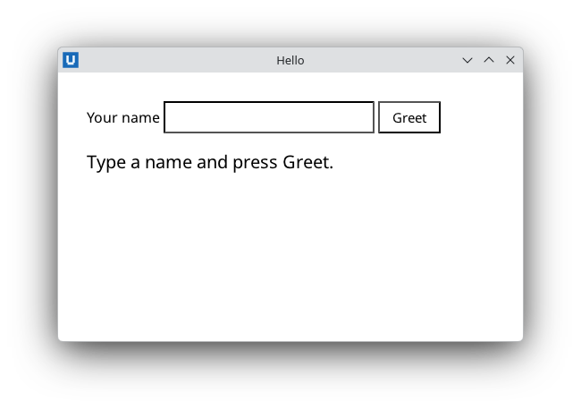
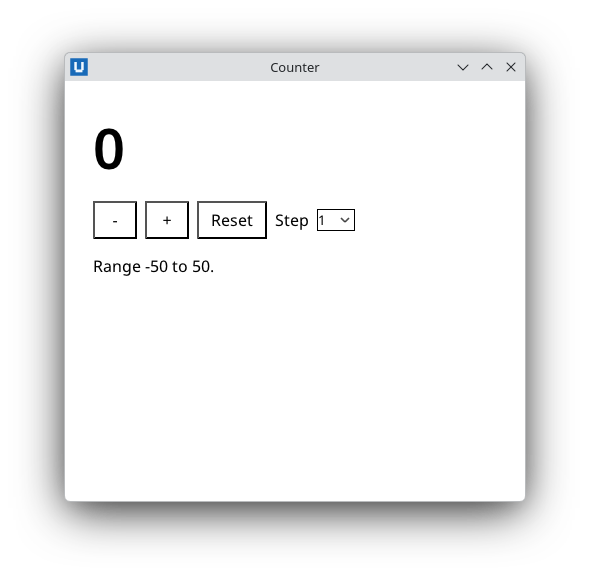
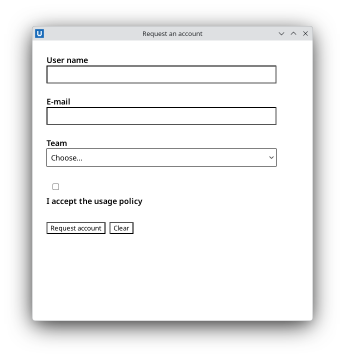
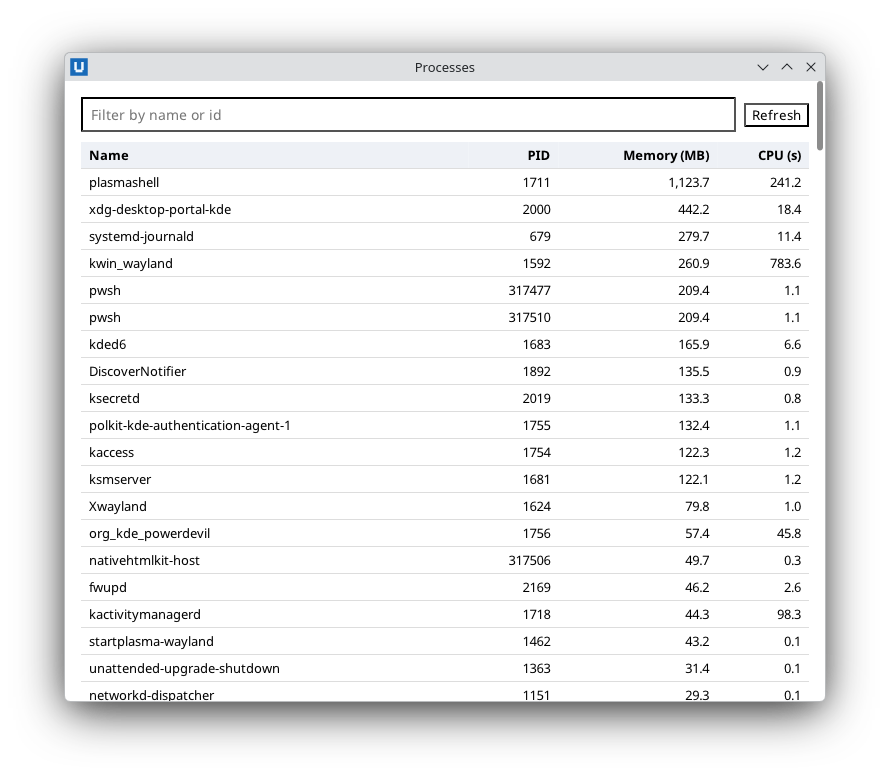
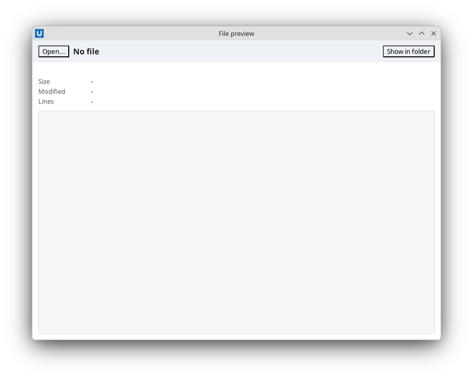
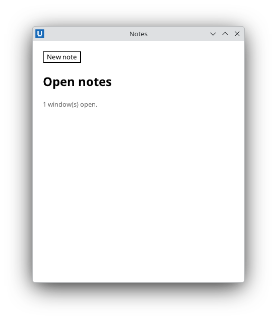
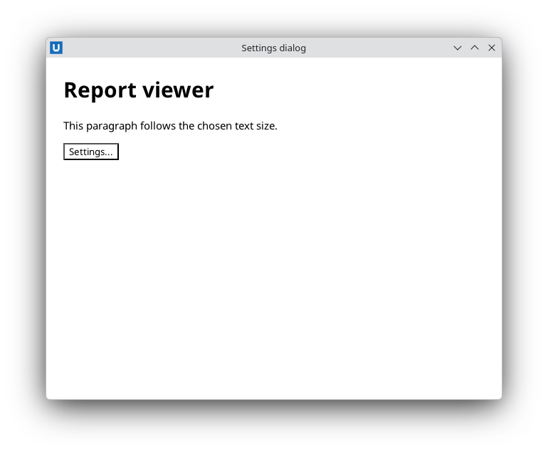
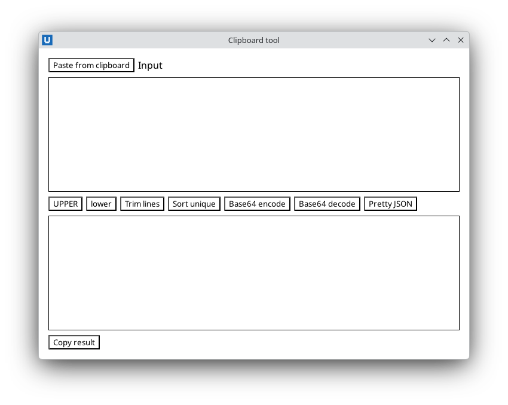
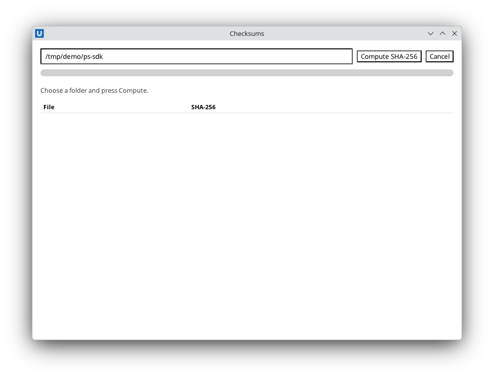
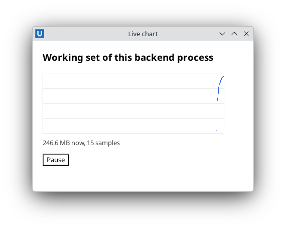

# NativeHTMLKit PowerShell examples

Small, complete desktop apps written with the `NativeHTMLKit` PowerShell SDK 0.1.2 (Core 1.0.3).
Each file is a standalone script: copy it, run it, change it. Every example works with
PowerShell 7.2+ on Linux and Windows and with Windows PowerShell 5.1.

```powershell
Install-Module NativeHTMLKit -Scope CurrentUser
pwsh -File ./04-todo-list.ps1                       # Windows PowerShell: powershell.exe -NoProfile -File .\04-todo-list.ps1
```

| Example | What it is | What it teaches |
|---|---|---|
| [01-hello.ps1](01-hello.ps1) | Greeting form | The lifecycle: start, window, document, event, ready, wait, close; safe text output. |
| [02-counter.ps1](02-counter.ps1) | Counter with step, limits, history | Script state, one delegated click handler for a button row, `<select>`, atomic `Invoke-NativeHTMLKitBatch`, `trim_children`. |
| [03-form-validation.ps1](03-form-validation.ps1) | Account request form | `submit` events, native constraints, PowerShell rules, per-field errors with `aria-invalid`, focus, reset. |
| [04-todo-list.ps1](04-todo-list.ps1) | Todo list | Model in PowerShell, rendering HTML with `HtmlEncode`, delegated handlers for re-rendered rows, filters. |
| [05-process-viewer.ps1](05-process-viewer.ps1) | Sortable process table | Tables from `Get-Process`, live filter from the `input` event's `value`, sortable headers with `aria-sort`. |
| [06-log-tail.ps1](06-log-tail.ps1) | Log follower (`-Path file`) | Polling with background tasks, appending lines, bounding the view, `set_scroll_follow`, highlighting. |
| [07-file-preview.ps1](07-file-preview.ps1) | Open-and-preview tool | Native Open dialog with filters, capability check, `RpcException` handling, file content as text, reveal in file manager. |
| [08-multi-window.ps1](08-multi-window.ps1) | Notes, one window per note | Several windows, per-window state, `.GetNewClosure()`, close policy vetoing unsaved notes, `window.event`, quit policy. |
| [09-settings-dialog.ps1](09-settings-dialog.ps1) | Settings dialog | HTML `<dialog>`, popover help, form inside a dialog, colour scheme override, replaceable stylesheet, JSON settings. |
| [10-clipboard-tool.ps1](10-clipboard-tool.ps1) | Text transformer | Clipboard read/write with fallback, transform functions, error messages for bad input. |
| [11-background-checksums.ps1](11-background-checksums.ps1) | SHA-256 of a folder | Background tasks in batches with a progress bar, cancel, timeout, `Receive-NativeHTMLKitTask`. |
| [12-live-chart.ps1](12-live-chart.ps1) | Live memory chart | Live RGBA bitmaps, fast pixel drawing in PowerShell, a timer from tasks. |
| [13-keyboard-shortcuts.ps1](13-keyboard-shortcuts.ps1) | Snippet editor | `keydown` chords, a shortcut table, `Set-NativeHTMLKitPreventDefault` for Tab, inserting at the caret, selection. |
| [14-diagnostics.ps1](14-diagnostics.ps1) | About / Support window | Capabilities, preferences, diagnostic counters, support bundles. |
| [bulk-rename/](bulk-rename/app.ps1) | Bulk file renamer (`app.ps1` + `index.html` + `style.css`) | The [tutorial](../docs/tutorials/bulk-rename.md) app: HTML/CSS files, a pure planning function, live preview, folder picker, confirm dialog, undo. |

## Conventions used in every example

- Side effects only **below** `Start-NativeHTMLKitScript`, because the launcher runs the script a
  second time as the host's backend ([why](../docs/guides/script-lifecycle.md)).
- `try { ... } finally { Close-NativeHTMLKit -Application $app }`.
- Untrusted text goes through `Set-NativeHTMLKitDocumentText` or `[Net.WebUtility]::HtmlEncode()`
  ([security](../docs/guides/security.md)).
- Handler logic lives in functions; the callbacks call them. This keeps callbacks short and lets the
  self-test call the same code.
- ASCII-only source (or UTF-8 with BOM) and no PowerShell 7-only operators, so Windows PowerShell
  5.1 runs them unchanged.

## Self-tests and the automated harness

Every example accepts `-SelfTest`: it drives the app through the public API (setting values,
submitting forms, calling the handler functions, reading the document back), prints
`SELFTEST PASS <name>` and requests a quit. Native input, painting, clipboard and file dialogs are
not available in the host's headless mode, so those paths are checked through their fallbacks.

`tests/Examples.Tests.ps1` runs every example with the real host in headless mode
(`NATIVEHTMLKIT_TEST_MODE=1`) and requires exit code 0, the PASS line, no error or warning on
stderr, no remaining host or backend process and no leftover launch manifest. It also parses every
example for Windows PowerShell 5.1 compatibility and runs a `New-NativeHTMLKitProject` scaffold and
the tutorial's first checkpoint:

```powershell
# From the repository root. Pester 5.5+ is required; NATIVEHTMLKIT_HOST_BINARY is only needed
# for a source checkout (an installed module bundles the host).
pwsh -NoProfile -File scripts/test-local.ps1 -Path tests/Examples.Tests.ps1 -HostBinary <path-to-nativehtmlkit-host> -RequireHost
powershell.exe -NoProfile -File scripts\test-local.ps1 -Path tests\Examples.Tests.ps1 -HostBinary <path-to-nativehtmlkit-host.exe> -RequireHost
```

To run one example headless by hand:

```powershell
$env:NATIVEHTMLKIT_TEST_MODE = '1'
pwsh -File ./03-form-validation.ps1 -SelfTest
```

More complete gallery-style demos across the NativeHTMLKit project are on the
[public site](https://github.com/nativehtmlkit/nativehtmlkit).

## Screenshots

Real captures on KDE Plasma 6.6 Wayland (100% scaling) with Core 1.0.3, PowerShell SDK 0.1.2 on PowerShell 7.7, taken by running each example unchanged. Windows looks the same apart from the window frame.

| | |
|---|---|
| [01-hello](01-hello.ps1)<br> | [02-counter](02-counter.ps1)<br> |
| [03-form-validation](03-form-validation.ps1)<br> | [04-todo-list](04-todo-list.ps1)<br> |
| [05-process-viewer](05-process-viewer.ps1)<br> | [06-log-tail](06-log-tail.ps1)<br> |
| [07-file-preview](07-file-preview.ps1)<br> | [08-multi-window](08-multi-window.ps1)<br> |
| [09-settings-dialog](09-settings-dialog.ps1)<br> | [10-clipboard-tool](10-clipboard-tool.ps1)<br> |
| [11-background-checksums](11-background-checksums.ps1)<br> | [12-live-chart](12-live-chart.ps1)<br> |
| [13-keyboard-shortcuts](13-keyboard-shortcuts.ps1)<br> | [14-diagnostics](14-diagnostics.ps1)<br> |
| [bulk-rename](bulk-rename/app.ps1)<br> |  |
