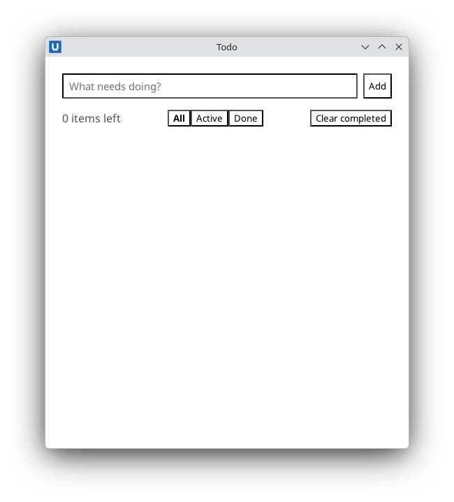
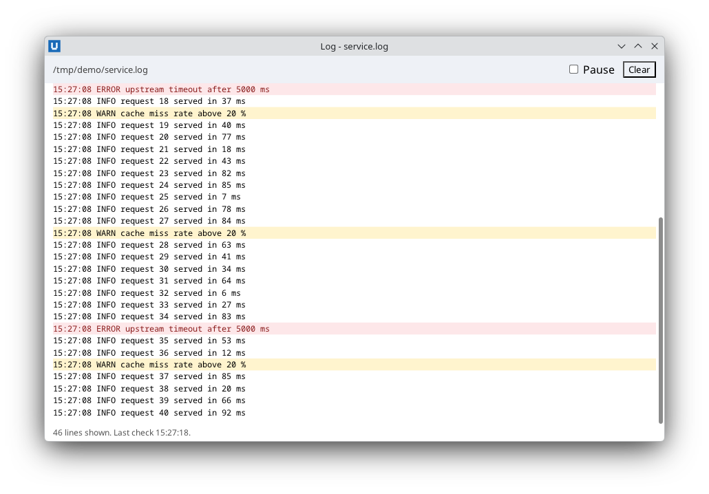
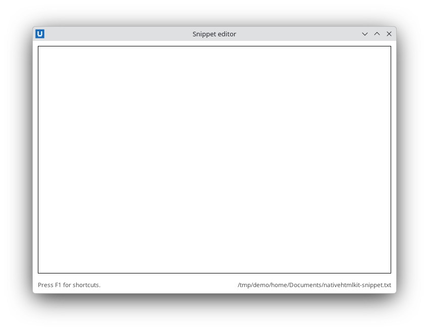
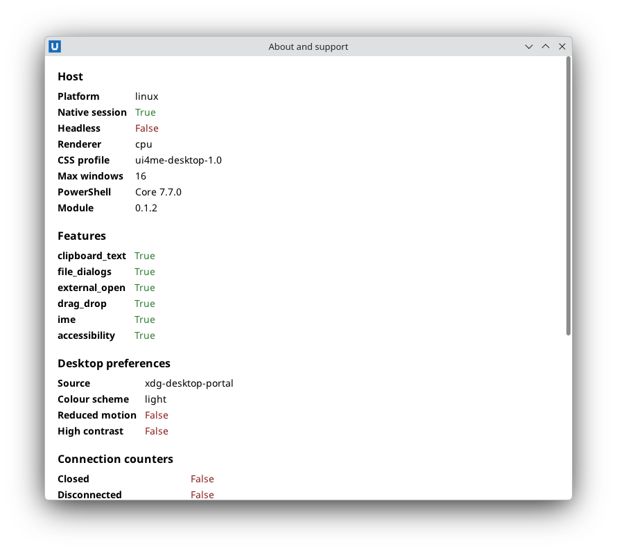
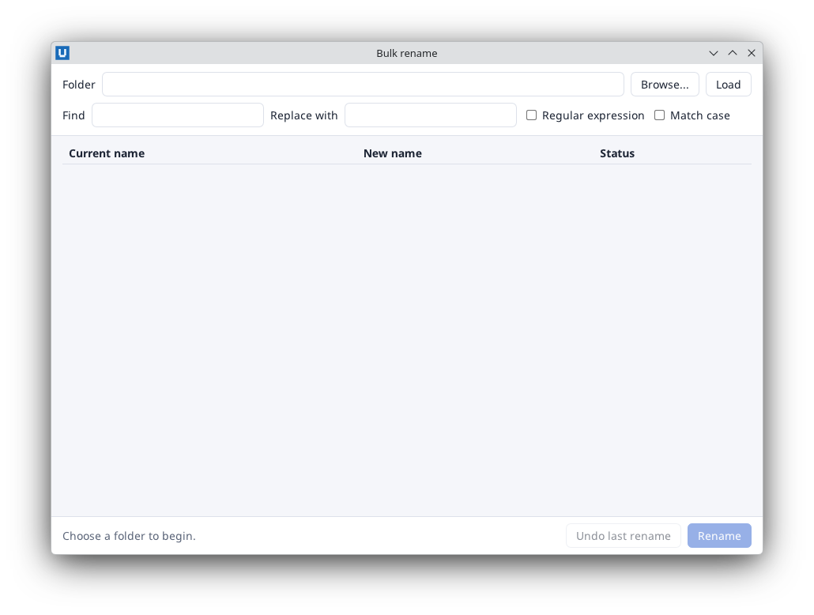

# NativeHTMLKit PowerShell examples

Twenty small, complete desktop apps written with the `NativeHTMLKit` PowerShell SDK 0.1.2 (Core 1.0.3).
Each file is a standalone script: copy it, run it, change it. Every example works with
PowerShell 7.2+ on Linux and Windows and with Windows PowerShell 5.1.

```powershell
Install-Module NativeHTMLKit -Scope CurrentUser
pwsh -File ./04-todo-list.ps1                       # Windows PowerShell: powershell.exe -NoProfile -File .\04-todo-list.ps1
```

| Example | Id | What it is | What it teaches |
|---|---|---|---|
| [01-hello.ps1](01-hello.ps1) | `hello` | Greeting form | The lifecycle: start, window, document, event, ready, wait, close; safe text output. |
| [02-counter.ps1](02-counter.ps1) | `counter` | Counter with step, limits, history | Script state, one delegated click handler for a button row, `<select>`, atomic `Invoke-NativeHTMLKitBatch`, `trim_children`. |
| [03-form-validation.ps1](03-form-validation.ps1) | `signup-form` | Sign-up form | Native constraint validation, one `invalid` event per failing control in an error summary, `set_custom_validity` for the password match, `Get-NativeHTMLKitFormData` with repeated names, encoded result, reset after success. |
| [04-todo-list.ps1](04-todo-list.ps1) | `todo` | Todo list saved to JSON | Form `submit`, delegated list events, `HtmlEncode`, edit in place, Escape, filters, `desktop.paths`, atomic saves. The [tutorial](../docs/tutorials/todo-app.md)'s final app. |
| [05-process-viewer.ps1](05-process-viewer.ps1) | `process-viewer` | Sortable process table | Tables from `Get-Process`, live filter from the `input` event's `value`, sortable headers with `aria-sort`. |
| [06-log-tail.ps1](06-log-tail.ps1) | `log-viewer` | Log follower (`-Path file`) | Polling with background tasks, appending lines, bounding the view, `set_scroll_follow`, highlighting. |
| [07-file-preview.ps1](07-file-preview.ps1) | `file-viewer` | File viewer and editor (`-Path file`) | Native Open, Save As and Choose Folder dialogs with filters, the dialog result, the -32001 fallback, UTF-8 and size checks, file content as a textarea value, folder list, window title. |
| [08-multi-window.ps1](08-multi-window.ps1) | `multi-window` | Window manager with note windows | Several windows, the window list, `Get-`/`Set-NativeHTMLKitWindow` (rename, resize, maximize), `window.event` log, per-window state with `.GetNewClosure()`, close policy vetoing unsaved notes, closing the main window quits. |
| [09-settings-dialog.ps1](09-settings-dialog.ps1) | `settings-dialog` | Settings dialog | HTML `<dialog>`, popover help, form inside a dialog, colour scheme override, replaceable stylesheet, JSON settings. |
| [10-clipboard-tool.ps1](10-clipboard-tool.ps1) | `clipboard-tool` | Clipboard tool | Text transforms from one delegated toolbar handler, clipboard Paste/Copy, `link_activated` with `Open-NativeHTMLKitExternal` (https only), desktop preferences with live updates, -32001 fallbacks, UTF-16 cursor offset. |
| [11-background-checksums.ps1](11-background-checksums.ps1) | `checksums` | SHA-256 of a folder | Background tasks in time-boxed batches with a progress bar, cancel with `Stop-NativeHTMLKitTask`, folder dialog, quit policy while busy. |
| [12-live-chart.ps1](12-live-chart.ps1) | `live-chart` | Live memory chart | Live RGBA bitmaps, fast pixel drawing in PowerShell, a timer from tasks. |
| [13-keyboard-shortcuts.ps1](13-keyboard-shortcuts.ps1) | `keyboard-shortcuts` | Snippet editor | `keydown` chords, a shortcut table, `Set-NativeHTMLKitPreventDefault` for Tab, inserting at the caret, selection. |
| [14-diagnostics.ps1](14-diagnostics.ps1) | `diagnostics` | About / Support window | Capabilities, preferences, diagnostic counters, support bundles. |
| [15-data-table.ps1](15-data-table.ps1) | `data-table` | Inventory table (`-Path inventory.csv`) | Search with the `input` event, `<select>` filter, sortable headers, paging, details pane, one batch per render; `Import-Csv` (PowerShell extra). |
| [16-dom-explorer.ps1](16-dom-explorer.ps1) | `dom-explorer` | Live DOM tree with editing | Node references for elements without ids, `Get-NativeHTMLKitNodeChildren`/`NodeInfo`, node operations, stale nodes. |
| [17-focus-timer.ps1](17-focus-timer.ps1) | `focus-timer` | Countdown timer | Quit policy with a confirmation `<dialog>`, saving after shutdown, `desktop.paths`, window title, attention request, a task-based tick. |
| [18-background-jobs.ps1](18-background-jobs.ps1) | `background-jobs` | Concurrent jobs with progress and cancel | Task chains for progress, `.GetNewClosure()` per job, `Stop-NativeHTMLKitTask`, the 8-task limit and a queue. |
| [bulk-rename/](bulk-rename/app.ps1) | `bulk-rename` | Bulk file renamer (`app.ps1` + `index.html` + `style.css`) | The [tutorial](../docs/tutorials/bulk-rename.md) app: HTML/CSS files, a pure planning function, live preview, folder picker, confirm dialog, undo. |
| [process-dashboard/](process-dashboard/app.ps1) | `process-dashboard` | Live process monitor (`-RefreshSeconds 3`) | The [tutorial](../docs/tutorials/process-dashboard.md) app: background refresh with `Start-NativeHTMLKitTask`, filter, sort, pause, copy. |

`Id` is the example's key in [catalog.toml](catalog.toml), the machine-readable list of examples
shared with the Python SDK: the Python example with the same id shows the same window and features.

Tutorial steps (each one a complete, runnable script):

- [Todo app](../docs/tutorials/todo-app.md):
  [step1-window.ps1](todo-tutorial/step1-window.ps1) ·
  [step2-add.ps1](todo-tutorial/step2-add.ps1) ·
  [step3-complete-delete.ps1](todo-tutorial/step3-complete-delete.ps1) ·
  [step4-edit-keyboard.ps1](todo-tutorial/step4-edit-keyboard.ps1) · step 5 is [04-todo-list.ps1](04-todo-list.ps1).
- [Process dashboard](../docs/tutorials/process-dashboard.md):
  [step1-snapshot.ps1](process-dashboard/step1-snapshot.ps1) ·
  [step2-filter.ps1](process-dashboard/step2-filter.ps1) · step 3 is [app.ps1](process-dashboard/app.ps1).

## Conventions used in every example

- Side effects only **below** `Start-NativeHTMLKitScript`, because the launcher runs the script a
  second time as the host's backend ([why](../docs/guides/lifecycle.md)).
- `try { ... } finally { Close-NativeHTMLKit -Application $app }`.
- Untrusted text goes through `Set-NativeHTMLKitDocumentText` or `[Net.WebUtility]::HtmlEncode()`
  ([security](../docs/guides/security.md)).
- Handler logic lives in functions; the callbacks call them. This keeps callbacks short and lets the
  self-test call the same code.
- ASCII-only source (or UTF-8 with BOM) and no PowerShell 7-only operators, so Windows PowerShell
  5.1 runs them unchanged.

## Self-tests and the automated harness

Every example accepts `-SelfTest`: it drives the app through the public API (setting values,
submitting forms, calling the handler functions, reading the document back), prints
`SELFTEST PASS <name>` and requests a quit. Native input, painting, clipboard and file dialogs are
not available in the host's headless mode, so those paths are checked through their fallbacks.

`tests/Examples.Tests.ps1` runs every example with the real host in headless mode
(`NATIVEHTMLKIT_TEST_MODE=1`) and requires exit code 0, the PASS line, no error or warning on
stderr, no remaining host or backend process and no leftover launch manifest. It also parses every
example for Windows PowerShell 5.1 compatibility, checks that every example has a
[catalog.toml](catalog.toml) entry (and every entry a file), runs the tutorial step scripts with a
read-back check, the `New-NativeHTMLKitProject` scaffold and the bulk-rename tutorial's first
checkpoint:

```powershell
# From the repository root. Pester 5.5+ is required; NATIVEHTMLKIT_HOST_BINARY is only needed
# for a source checkout (an installed module bundles the host).
pwsh -NoProfile -File scripts/test-local.ps1 -Path tests/Examples.Tests.ps1 -HostBinary <path-to-nativehtmlkit-host> -RequireHost
powershell.exe -NoProfile -File scripts\test-local.ps1 -Path tests\Examples.Tests.ps1 -HostBinary <path-to-nativehtmlkit-host.exe> -RequireHost
```

To run one example headless by hand:

```powershell
$env:NATIVEHTMLKIT_TEST_MODE = '1'
pwsh -File ./03-form-validation.ps1 -SelfTest
```

More complete gallery-style demos across the NativeHTMLKit project are on the
[public site](https://github.com/nativehtmlkit/nativehtmlkit).

## Screenshots

Real captures on KDE Plasma 6.6 Wayland (100% scaling) with Core 1.0.3, PowerShell SDK 0.1.2 on PowerShell 7.7, taken by running each example unchanged. Examples without a picture here changed after the last capture. Windows looks the same apart from the window frame.

| | |
|---|---|
| [01-hello](01-hello.ps1)<br> | [02-counter](02-counter.ps1)<br> |
| [04-todo-list](04-todo-list.ps1)<br> | [05-process-viewer](05-process-viewer.ps1)<br> |
| [06-log-tail](06-log-tail.ps1)<br> | [09-settings-dialog](09-settings-dialog.ps1)<br> |
| [12-live-chart](12-live-chart.ps1)<br> | [13-keyboard-shortcuts](13-keyboard-shortcuts.ps1)<br> |
| [14-diagnostics](14-diagnostics.ps1)<br> | [bulk-rename](bulk-rename/app.ps1)<br> |
| [process-dashboard](process-dashboard/app.ps1)<br> |  |
